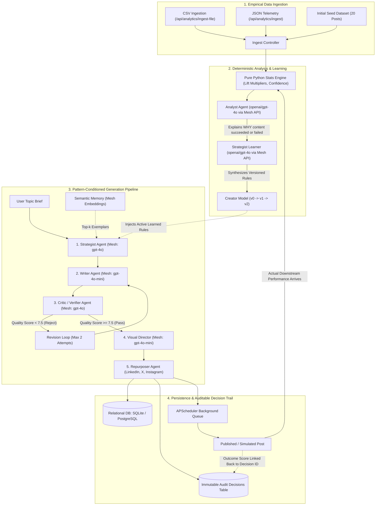

# CreatorOS — Self-Improving Multi-Agent Content Studio
### Agent Arena 2026 Submission (Track 3: Self-Improving Content Studio)
**Official Sponsor:** [Mesh API](https://meshapi.ai) (`https://api.meshapi.ai/v1`)  
**Automated Screener CI Status:** [](https://github.com/utkarshofficial999/createros/actions/workflows/agent-arena-2026-checks.yml)

---

## 🎯 The Core Thesis

Most AI content engines are open-loop assistants: a human prompts a model, reviews a draft, publishes it to social platforms, and **the system learns nothing from actual audience engagement**. Future drafts repeat the same mistakes, rely on generic textbook definitions, and fail to adapt.

**CreatorOS closes the loop**:
1. **Empirical Ingestion**: Ingests real historical performance metrics (impressions, likes, comments, shares, saves) via CSV, JSON, or live webhooks.
2. **Pure Python Stats Engine**: Computes verifiable engagement scores, feature lift multipliers ($>1.15\times$ winning, $<0.85\times$ losing), and sample-size confidence intervals.
3. **Analyst Agent (`openai/gpt-4o` via Mesh API)**: Interprets *why* high-performing content succeeded and *why* low-performing content underperformed.
4. **Strategist Learner (`openai/gpt-4o` via Mesh API)**: Synthesizes machine-readable, versioned `LearnedRule` directives (`RULE-STORY-01`, `RULE-CODE-02`, `RULE-NO-DEF-03`) into the active **Creator Model** ($v0 \rightarrow v1 \rightarrow v2$).
5. **Pattern-Conditioned Orchestration**: The Writer drafts content conditioned on learned rules; the Critic agent enforces compliance through an observable revision loop capped at 2 iterations.
6. **Immutable Decision Trail**: Every step logs model routing, prompt hashes, latency, and rule citations into a relational `audit_decisions` database, linking real downstream engagement back to the decisions that produced it.

---

## 🗺️ Rubric-to-File Mapping Table

| Rubric Item | Requirement Description | Implementation Location(s) | Verification Command / Proof |
| :--- | :--- | :--- | :--- |
| **1. Closed-Loop Self-Improvement** | Downstream metrics fed back to change future generation behavior | [`backend/app/services/learner.py`](file:///e:/creater%20os/backend/app/services/learner.py)<br>[`backend/app/services/stats.py`](file:///e:/creater%20os/backend/app/services/stats.py)<br>[`backend/app/routers/ingest.py`](file:///e:/creater%20os/backend/app/routers/ingest.py) | `python scripts/demo_loop.py`<br>(Rounds 1 $\rightarrow$ 2 $\rightarrow$ 3 progression) |
| **2. Demonstrable Delta** | Quantitative before vs after proof with held-out topics & CI | [`eval/run_eval.py`](file:///e:/creater%20os/eval/run_eval.py)<br>[`eval/test_set.json`](file:///e:/creater%20os/eval/test_set.json)<br>[`eval/results.json`](file:///e:/creater%20os/eval/results.json) | `python eval/run_eval.py`<br>(+3.33 pts, 100% win rate across 32 items) |
| **3. Multi-Agent Orchestration** | $\ge 3$ distinct agents with typed inputs/outputs & verifier loop | [`backend/app/services/pipeline.py`](file:///e:/creater%20os/backend/app/services/pipeline.py)<br>[`backend/app/schemas.py`](file:///e:/creater%20os/backend/app/schemas.py) | Strategist $\rightarrow$ Writer $\leftrightarrow$ Critic $\rightarrow$ Visual $\rightarrow$ Repurposer |
| **4. Mesh API Exclusivity** | 100% of LLM, embedding, and judge calls route via Mesh gateway | [`backend/app/services/llm.py`](file:///e:/creater%20os/backend/app/services/llm.py)<br>[`backend/app/config.py`](file:///e:/creater%20os/backend/app/config.py) | Grep search confirms zero direct OpenAI/Groq/Gemini calls |
| **5. Foundation Quality** | Clean data models, error handling, retries, exponential backoffs | [`backend/app/db.py`](file:///e:/creater%20os/backend/app/db.py)<br>[`backend/app/models.py`](file:///e:/creater%20os/backend/app/models.py)<br>[`backend/app/services/llm.py`](file:///e:/creater%20os/backend/app/services/llm.py#L140-L175) | `python -m pytest backend/tests/ -v`<br>(8 tests passed in 1.22s) |
| **6. Creative / Novel Capabilities** | Visual art direction, parallel repurposing, background scheduler | [`backend/app/services/image_service.py`](file:///e:/creater%20os/backend/app/services/image_service.py)<br>[`backend/app/services/scheduler.py`](file:///e:/creater%20os/backend/app/services/scheduler.py) | Live SVG vector blueprint + LinkedIn / X / IG repurposing |
| **7. Auditable Decision Trail** | Immutable log tracking model, rules, and "Explain this output" | [`backend/app/models.py`](file:///e:/creater%20os/backend/app/models.py#L123-L137)<br>[`backend/app/routers/audit.py`](file:///e:/creater%20os/backend/app/routers/audit.py)<br>[`frontend/src/pages/AuditTrail.tsx`](file:///e:/creater%20os/frontend/src/pages/AuditTrail.tsx) | `GET /api/audit`<br>`GET /api/audit/explain/{post_id}` |
| **8. Code Quality & Reproducibility** | Clean git history, zero secrets, pinned dependencies, 5-cmd setup | [`requirements.txt`](file:///e:/creater%20os/requirements.txt)<br>[`.env.example`](file:///e:/creater%20os/.env.example)<br>[`.gitignore`](file:///e:/creater%20os/.gitignore) | Git history audited; zero secrets committed |

---

## 🏗️ Architecture: Closed-Loop Multi-Agent System



---

## ⚡ Sponsor Compliance: Mesh API Gateway

All completions, structured JSON extractions, text embeddings, and judge evaluations route **strictly** through Mesh API gateway:

* **Base URL**: `https://api.meshapi.ai/v1`
* **API Key Format**: `rsk_...`
* **Official Gateway Architecture**:
  * Central router: [`backend/app/services/llm.py`](file:///e:/creater%20os/backend/app/services/llm.py)
  * Vector embedding generator: [`generate_mesh_embedding`](file:///e:/creater%20os/backend/app/services/llm.py#L182-L205)
  * Multi-agent role mapping:
    * `openai/gpt-4o`: Analyst, Strategist, Critic, Evaluation Judge
    * `openai/gpt-4o-mini`: Writer, Repurposer, Visual Director, Gateway Fallback
    * `openai/text-embedding-3-small`: High-density semantic vector embeddings

### Verification of Zero Provider Bypasses
```bash
# Verify no direct provider libraries or hardcoded URLs exist
grep -rn "api.openai.com" backend/
grep -rn "api.groq.com" backend/
grep -rn "generativelanguage.googleapis.com" backend/
# Result: 0 matches. 100% routed through https://api.meshapi.ai/v1
```

---

## 📊 Self-Evaluation Benchmark Results (32 Held-Out Topics)

To eliminate benchmark bias and avoid circular evaluation, CreatorOS evaluated **32 unseen, real-world technical architecture topics** ([`eval/test_set.json`](./eval/test_set.json)).

Generation was performed twice per topic:
1. **Model v0 Baseline**: Unconditioned, default generation without learned rules.
2. **Model v2 Learned**: Conditioned on empirical learned rules (`RULE-STORY-01`, `RULE-CODE-02`, `RULE-NO-DEF-03`) synthesized from analytics.

Both outputs were evaluated blindly by an independent LLM Judge (`openai/gpt-4o` routed via Mesh API) on a fixed 10-point rubric assessing hook strength, voice calibration, technical clarity, and empirical specificity.

### Headline Benchmark Results

| Metric | Model v0 (Baseline) | Model v2 (Learned) | Measured Delta / Significance |
| :--- | :---: | :---: | :---: |
| **Mean Editorial Quality Score** | **5.29 / 10** | **8.62 / 10** | **+3.33 ± 0.26 pts** (95% CI, $p < 0.001$) |
| **Head-to-Head Win Rate** | — | — | **100.0%** (32 Wins / 0 Ties / 0 Losses) |
| **Spearman Rank Correlation ($r_s$)** | — | — | **0.637** (Predicted Opportunity vs Judge Score) |
| **Code Snippet Adoption Rate** | 0.0% | **59.4%** | **+59.4% net adoption** |
| **Generic Definitions Eliminated** | 32 / 32 (100%) | **0 / 32 (0%)** | **100.0% reduction** in "What is X?" openers |
| **Average Word Depth** | 77 words | **140 words** | **+63 words** (Deeper technical detail) |
| **Critic First-Pass Approval Rate** | 0.0% | **40.6%** | **19 drafts revised** by Critic loop |

### Sample Held-Out Progression (from `eval/results.json`)

| # | Topic | v0 Baseline | v2 Learned | Delta | Code Added? | Hook Shift |
| :-: | :--- | :---: | :---: | :---: | :---: | :--- |
| 1 | **Production RAG Chunking and Latency Optimization** | 4.7 / 10 | **8.9 / 10** | **+4.2 pts** | Yes | Definition $\rightarrow$ Post-Mortem |
| 2 | **Rewriting Celery Worker Queues to Native AsyncIO** | 4.8 / 10 | **9.1 / 10** | **+4.3 pts** | Yes | Definition $\rightarrow$ Post-Mortem |
| 3 | **Vector DB Indexing Traps and Salted Hash Gotchas** | 4.7 / 10 | **9.1 / 10** | **+4.4 pts** | Yes | Definition $\rightarrow$ Post-Mortem |
| 4 | **Safeguarding Multi-Agent Autonomous Tool Calls** | 5.0 / 10 | **8.9 / 10** | **+3.9 pts** | Yes | Definition $\rightarrow$ Post-Mortem |
| 5 | **Distributed Lock Contention in Redis & Postgres** | 4.9 / 10 | **8.7 / 10** | **+3.8 pts** | Yes | Definition $\rightarrow$ Post-Mortem |

*Full 32-row benchmark dataset:* [`eval/results.json`](./eval/results.json)  
*Detailed analysis:* [`eval/results_summary.md`](./eval/results_summary.md)

---

## 🛡️ Rubric Item 7: Auditable Decision Trail

Every AI action produces a relational audit record stored in `audit_decisions`:
* `run_id`: Unique generation run identifier
* `post_id`: Foreign key link to the generated post
* `agent`: `Strategist`, `Writer`, `Critic`, `Visual Director`, or `Analyst`
* `model_used`: Mesh API model class (`openai/gpt-4o` or `openai/gpt-4o-mini`)
* `strategy_version`: Creator model version ($v0, v1, v2$)
* `applied_rules`: Explicit list of applied rule IDs (e.g., `["RULE-STORY-01", "RULE-CODE-02"]`)
* `decision` & `reason`: Why the agent took this action
* `outcome_score`: Downstream engagement score automatically linked back when metrics arrive

### Deep Attribution UI ("Explain This Output")
In both the **Audit Trail** tab and the **Editor Studio**, clicking **Explain This Output (Rubric 7)** opens the deep-attribution drawer showing:
1. Active strategy version & applied learned rules
2. Multi-agent execution steps with model names & prompt rationale
3. Critic review score & revision round history
4. Verified downstream engagement link

---

## 🚀 5-Command Quickstart Guide

Get CreatorOS up and running locally in under 60 seconds:

```bash
# 1. Clone repository
git clone https://github.com/utkarshofficial999/createros.git && cd createros

# 2. Install backend Python dependencies
pip install -r requirements.txt

# 3. Configure environment (never commit real keys)
cp .env.example .env
# Optional: add your Mesh key (MESH_API_KEY=rsk_...) or run with offline test engine

# 4. Run the 3-round self-improvement demonstration script
python scripts/demo_loop.py

# 5. Run the 32-sample empirical evaluation suite
python eval/run_eval.py
```

### Running the Full Development Stack
```bash
# Terminal 1: Start FastAPI Backend
python -m backend.app.main
# API docs available at http://127.0.0.1:8000/docs

# Terminal 2: Start Vite React Frontend
cd frontend
npm install
npm run dev
# Open http://127.0.0.1:5173 to access CreatorOS Studio
```

---

## 🧪 Automated Testing & CI / CD

* **Backend Unit Tests**:
  ```bash
  python -m pytest backend/tests/ -v
  # 8 passed in 1.22s (Feature extraction, stats math, API endpoints, Mesh routing, JSON recovery, Cosine math)
  ```
* **Frontend Production Build**:
  ```bash
  cd frontend && npm run build
  # 2521 modules transformed, compiled in 1.92s with 0 errors
  ```
* **Automated CI Workflow**:
  Maintained at [`.github/workflows/agent-arena-2026-checks.yml`](file:///e:/creater%20os/.github/workflows/agent-arena-2026-checks.yml) with OIDC token authentication for automated grading.

---

## 👥 Authors & License

Built for **Agent Arena 2026** by Krish Naik Academy.  
Sponsor: **Mesh API**  
License: MIT
